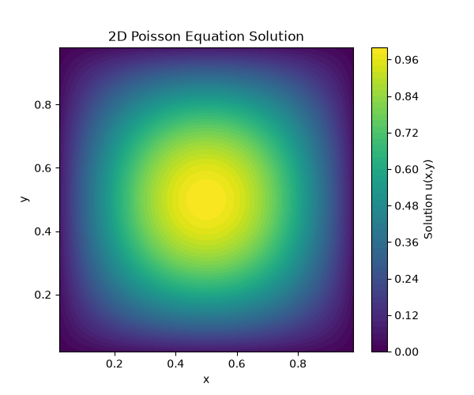
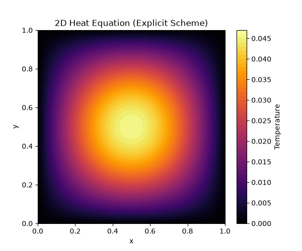

# Finite Difference Solvers for Fundamental PDEs

This repository contains Python implementations of numerical solvers for the 2D Heat Equation and the 2D Poisson Equation using Finite Difference Methods (FDM) on rectangular domains with homogeneous Dirichlet boundary conditions.

This project was developed to demonstrate rigorous implementation of numerical schemes, utilizing fully vectorized `NumPy` array operations and `SciPy` sparse matrix algebra to ensure computational efficiency.

## 📌 Features

* **2D Poisson Equation Solver (`poisson_2d_solver.py`):** Implements a second-order 5-point stencil Laplacian solver. The 2D sparse operator is constructed using Kronecker sums (`scipy.sparse.kronsum`) in Compressed Sparse Column (CSC) format to avoid dense matrix memory bottlenecks.

* **2D Heat Equation Solver (`heat_2d_solver.py`):** Implements a fully vectorized Explicit Euler (Forward-Time Central-Space) scheme simulating the diffusion of a 2D Gaussian pulse.

* **Stability Analysis:** Automatic calculation and enforcement check of the 2D Courant–Friedrichs–Lewy (CFL) stability criterion ($\text{CFL}_x + \text{CFL}_y \le 0.5$) for explicit time-stepping.

## 🧮 Mathematical Formulation

### 2D Poisson Equation

The elliptic boundary value problem is given by:

```math
\nabla^2 u = \frac{\partial^2 u}{\partial x^2} + \frac{\partial^2 u}{\partial y^2} = f(x,y), \quad (x,y) \in (0, L) \times (0, W)
```

with $u = 0$ on the boundary, tested against the analytical source term $f(x,y) = -2\pi^2 \sin(\pi x)\sin(\pi y)$.

This is discretized over interior grid points using the standard second-order central difference 5-point stencil:

```math
\frac{u_{i+1,j} - 2u_{i,j} + u_{i-1,j}}{\Delta x^2} + \frac{u_{i,j+1} - 2u_{i,j} + u_{i,j-1}}{\Delta y^2} = f_{i,j}
```

By mapping the 2D grid indices $(i,j)$ to a 1D vector, the system is formulated as a linear matrix equation $L_{2D} u = f$. The block-tridiagonal operator $L_{2D} = I_y \otimes D_x + D_y \otimes I_x$ is constructed via `scipy.sparse.kronsum` and solved directly using `scipy.sparse.linalg.spsolve`.

### 2D Heat Equation

The parabolic diffusion equation is given by:

```math
\frac{\partial u}{\partial t} = \alpha \left( \frac{\partial^2 u}{\partial x^2} + \frac{\partial^2 u}{\partial y^2} \right)
```

Discretized using a first-order forward difference in time and second-order central differences in space:

```math
u_{i,j}^{n+1} = u_{i,j}^n + \text{CFL}_x \left(u_{i,j+1}^n - 2u_{i,j}^n + u_{i,j-1}^n\right) + \text{CFL}_y \left(u_{i+1,j}^n - 2u_{i,j}^n + u_{i-1,j}^n\right)
```

where $\text{CFL}_x = \frac{\alpha \Delta t}{\Delta x^2}$ and $\text{CFL}_y = \frac{\alpha \Delta t}{\Delta y^2}$, requiring $\text{CFL}_x + \text{CFL}_y \le 0.5$ for numerical stability.

## 📈 Results

### 2D Poisson Equation Solution


### 2D Heat Equation (Diffusion of a Gaussian Pulse)


## 🚀 Usage

1. **Clone the repository:**
   ```bash
   git clone https://github.com/med-bedis-benlakhdhar/FDM-PDE-Solvers.git
   cd FDM-PDE-Solvers
   ```

2. **Install dependencies:**
   ```bash
   pip install -r requirements.txt
   ```

3. **Run the solvers to generate the plots:**
   ```bash
   python poisson_2d_solver.py
   python heat_2d_solver.py
   ```

## 🛠️ Requirements

* Python 3.8+
* NumPy
* SciPy
* Matplotlib