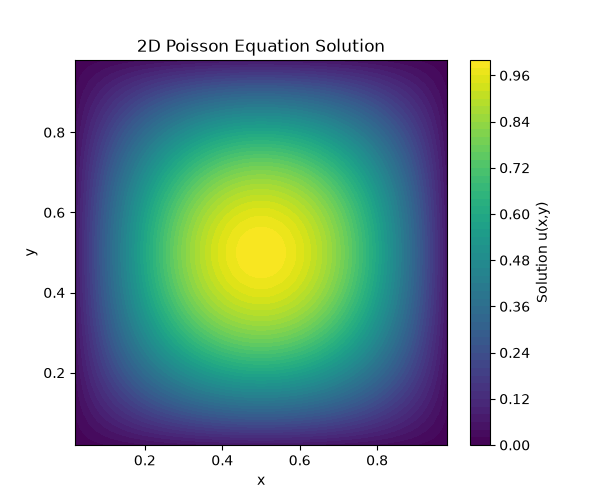
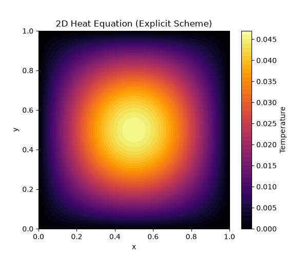

# Finite Difference Solvers for Fundamental PDEs

This repository contains Python implementations of numerical solvers for the 1D/2D Heat Equation and the 2D Poisson Equation using Finite Difference Methods (FDM). 

This project was developed to demonstrate rigorous implementation of numerical schemes, utilizing fully vectorized `NumPy` array operations and `SciPy` sparse matrix algebra to ensure computational efficiency.

## 📌 Features
* **Poisson Equation (2D):** Implemented a 5-point stencil Laplacian solver. The 2D sparse matrix is constructed elegantly using Kronecker sums (`scipy.sparse.kronsum`) to avoid dense matrix memory bottlenecks.
* **Heat Equation (1D & 2D):** Implemented Explicit Euler, Implicit Euler, and Crank-Nicolson schemes. 
* **Stability Analysis:** Explicit enforcement and empirical validation of the Courant-Friedrichs-Lewy (CFL) stability limit for explicit time-stepping schemes.

## 🧮 Mathematical Formulation

### 2D Poisson Equation
The Poisson equation is given by:
```math
\nabla^2 u = f(x,y)
```

This is discretized using the standard second-order central difference 5-point stencil:
```math
\frac{u_{i+1,j} - 2u_{i,j} + u_{i-1,j}}{\Delta x^2} + \frac{u_{i,j+1} - 2u_{i,j} + u_{i,j-1}}{\Delta y^2} = f_{i,j}
```
By mapping the 2D grid indices $(i,j)$ to a 1D vector $k$, the system is formulated as a linear matrix equation $Au = f$. The matrix $A$ is constructed using the Kronecker sum of 1D discrete Laplacians, resulting in a highly sparse block-tridiagonal matrix solved via `scipy.sparse.linalg.spsolve`.

## 📈 Results

### 2D Poisson Solution


### 2D Heat Equation (Diffusion of a Gaussian pulse)


## 🚀 Usage

Clone the repository and install dependencies:

```bash
git clone https://github.com/med-bedis-benlakhdhar/FDM-PDE-Solvers.git
cd FDM-PDE-Solvers
pip install -r requirements.txt
```
Run the solvers to generate the plots:
```bash
python poisson_2d_solver.py
python heat_2d_solver.py
```
## 🛠️ Requirements
* Python 3.8+
* NumPy
* SciPy
* Matplotlib